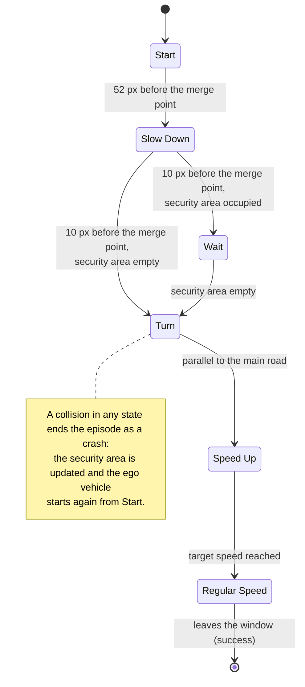
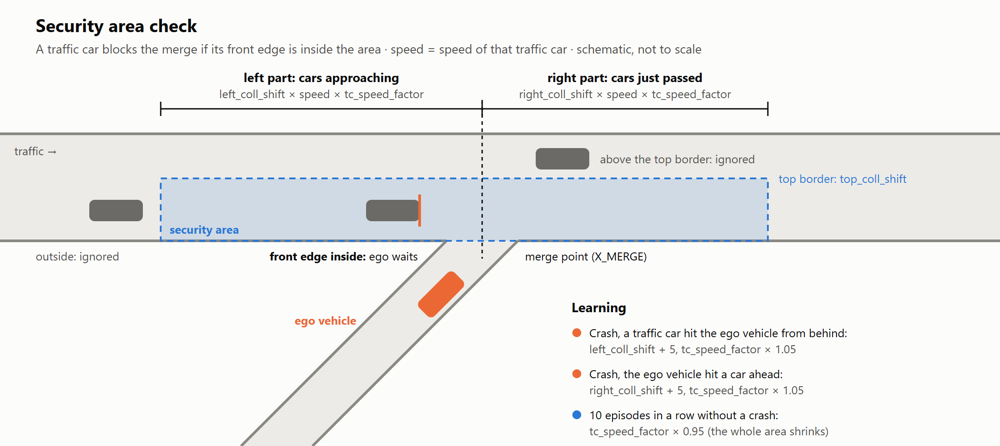

# Simulation-of-Autonomous-Road-Merging

*Course project · Autonomous Vehicle · [Afeka Tel Aviv Academic College of Engineering](https://www.afeka.ac.il/) · 2020*

---

Development of an autonomous road merging simulation with adaptive learning behavior.  
The simulation models autonomous vehicle merging from a secondary road into a main traffic road.

**Development Tools:** Python, Pygame  

**Main Concepts:**  
Adaptive security area, autonomous merging logic, collision detection, state-machine based control, dynamic traffic simulation.

---

## Overview

The project was inspired by:
- adaptive cruise control systems,
- slot-based merging approaches,
- autonomous driving decision-making algorithms.

The simulation models:
- traffic vehicles with dynamic speeds,
- autonomous merging behavior,
- collision detection,
- adaptive security areas,
- environment state transitions,
- basic learning behavior based on previous collisions.

The ego vehicle performs merging using a finite-state logic:
- Start
- Slow Down
- Wait
- Turn
- Speed Up
- Regular Speed

The adaptive learning mechanism updates the security area near the merge point according to:
- collision direction,
- traffic speed,
- previous failures.

The security area grows after a crash, on the side the collision came from, and slowly shrinks
while there are no crashes, to reduce waiting. See [Algorithm](#algorithm) for the exact rules.

---

## Core Idea

The project is inspired by slot-based autonomous merging approaches such as iPCB and GeoACC.

The main idea is to create a dynamic security area near the merge point and allow the ego vehicle to enter the main road only when the area is considered safe.

The security area adapts according to:
- previous collisions,
- traffic speed,
- collision direction,
- environment behavior over time.

This creates a simple adaptive learning mechanism that improves merging behavior after failures.


---

## Algorithm

The simulation runs at 40 frames per second. Traffic cars enter the main road on the left every
40 frames with a random speed of 3–6 px/frame and drive to the right; a faster car that comes
within 100 px of a slower car ahead takes its speed. The ego vehicle starts on the secondary road
at 10 px/frame and has to join the main road at the merge point.

### Merge state machine

`Step()` is called every frame and moves the ego vehicle through these states:



| State | What the ego vehicle does | Next state |
|---|---|---|
| Start | drives at 10 px/frame | Slow Down, 52 px before the merge point |
| Slow Down | decelerates by 1 px/frame each frame, down to 3 px/frame | at 10 px before the merge point: Turn if the security area is empty, otherwise Wait |
| Wait | stops and checks the security area every frame | Turn, as soon as the area is empty |
| Turn | turns by 1° per frame at 3 px/frame until it is parallel to the main road | Speed Up |
| Speed Up | accelerates by 1 px/frame each frame | Regular Speed, at 10 px/frame or at the speed of a slower car ahead in its lane |
| Regular Speed | keeps its speed; traffic cars behind it slow down to it | the episode ends when it leaves the window |

The slowdown point (52 px) is calculated from the deceleration, so that the car reaches the
turning speed by the decision point. Once the turn has started, the decision is not changed.

### Security area check



Before turning, `if_allow_turn()` checks that no traffic car has its front edge inside the
security area:

```
X_MERGE − left_coll_shift × speed × tc_speed_factor  <  front edge  <  X_MERGE + right_coll_shift × speed × tc_speed_factor
```

`speed` is the speed of that traffic car. In effect, `shift × tc_speed_factor` is a time margin
in frames, and multiplying it by the car's speed turns it into a distance: a fast car is taken
into account farther from the merge point than a slow one.

- The **left** part covers cars approaching the merge point (they could hit the ego vehicle from behind).
- The **right** part covers cars that have just passed it (the ego vehicle could hit them).
- Only the lanes the ego vehicle crosses during the turn are checked: the top border is the highest
  point the ego vehicle reaches while turning in the first episode.

At the start both shifts are 0, so the area is empty and the ego vehicle merges without waiting.

### Learning

The security area is updated by two rules:

- **After a crash, it grows** (`update_coll_shifts()`): if a traffic car hit the ego vehicle
  from behind, `left_coll_shift` increases by 5; if the ego vehicle hit a car ahead,
  `right_coll_shift` increases by 5. In both cases `tc_speed_factor` is multiplied by 1.05.
- **After every 10 episodes without a crash, it shrinks** (`ResetPlayerCar()`):
  `tc_speed_factor` is multiplied by 0.95.

The shifts never decrease: they learn the *shape* of the area, i.e. from which side crashes come.
`tc_speed_factor` sets its overall *scale*: it grows after crashes and slowly shrinks while there
are none, which reduces waiting. With learning disabled the shifts stay 0, so the ego vehicle
never waits.

---

## Simulation Screenshot


The simulation window displays:
- traffic vehicles on the main road,
- the ego vehicle entering from the secondary road,
- adaptive security area parameters,
- vehicle speed,
- steering angle,
- acceleration,
- statistics of successful and failed merging attempts.

---

## Results

To measure the effect of the adaptive security area, the simulation was run without the window
(see `experiments/`) for 2,000 episodes, 5 times with different random traffic.
For comparison, the same runs were made with learning disabled: the security area is not updated
after a crash, so the ego vehicle merges without checking the traffic.


| | Without learning | With adaptive security area |
|---|---:|---:|
| Crashes, episodes 1–50 | 47% | 14% |
| Crashes, episodes 101–500 | 44% | 3.3% |
| Crashes, episodes 1001–2000 | 45% | 6.0% |
| Average episode duration | 5.6 s | 7.8 s |

- **The security area learns fast:** the crash rate falls from about 47% to a few percent
  within the first 100 episodes.
- **It does not go to zero by design:** after a crash the security area grows, and after every
  10 episodes without crashes it shrinks by 5% to reduce waiting
  (see [Learning](#learning)). These two rules balance at about 5–6% crashes –
  a trade-off between safety and waiting time.
- **The price of safety is waiting:** the ego vehicle waits more often before the merge point,
  so an episode lasts 7.8 s instead of 5.6 s.

---

## Main Features

- Autonomous merge decision making
- Dynamic traffic generation
- Collision detection
- Adaptive security area learning
- State-machine based vehicle control
- Traffic speed adaptation
- Visual simulation using Pygame

---

## Code Structure

### PlayerCar
- ResetPlayerCar
- CrashProcess
- Update

### Environment
- Get_start_slowdown_point
- Get_dist_till_merge
- Update
- If_allow_turn
- Update_coll_shifts
- Step

---

## Running the Project

Install dependencies:

```bash
pip install pygame
```

Run the simulation:

```bash
python roads_merge_simulation.py
```

Reproduce the results (no window; pygame drawing is replaced by a stub, the simulation logic runs unchanged):

```bash
python experiments/run_headless.py roads_merge_simulation.py results/run_s1_L1.csv 2000 1 1
python experiments/run_headless.py roads_merge_simulation.py results/run_s1_L0.csv 2000 1 0
python experiments/plot_crash_rate.py results image/crash_rate.svg
```

Each run writes one CSV row per episode (crash flag, duration in frames, security area values).
The last argument of `run_headless.py` turns learning on (1) or off (0); the chart above uses seeds 1–5.

---

## Notes

This project was developed as part of a group academic project.

The implementation and programming were primarily written by me.
